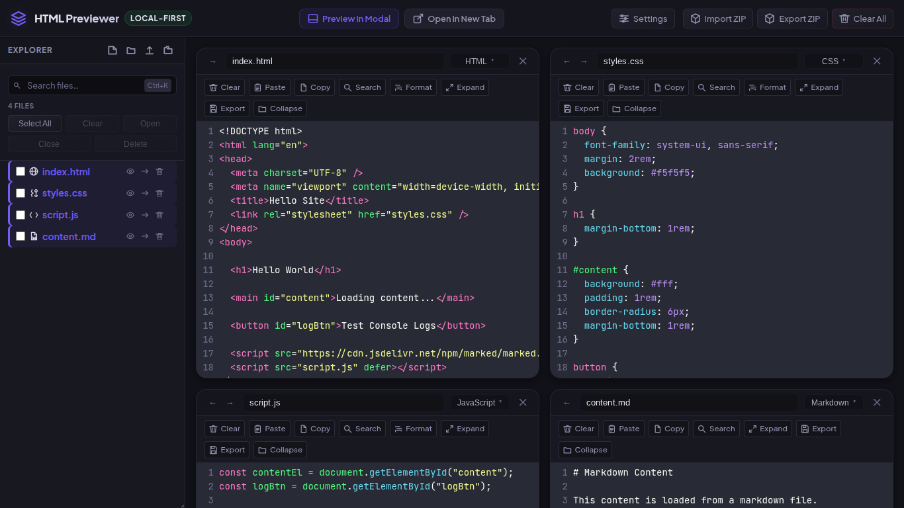
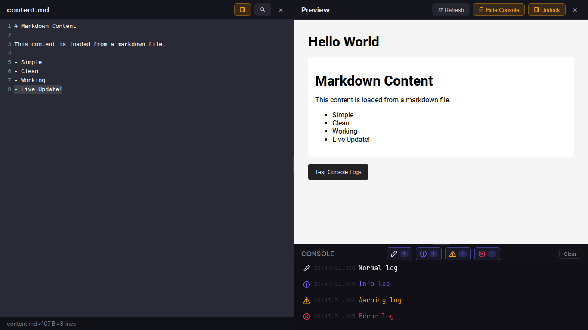
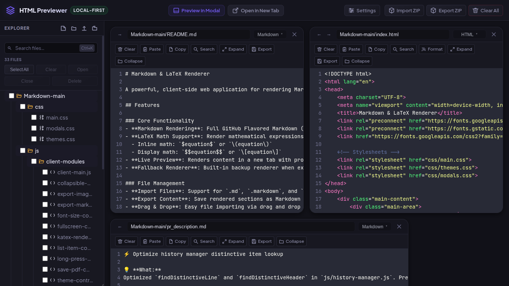

# HTML Previewer

A streamlined, local-first frontend playground to build, organize, and preview full web projects directly in your browser.



## Features

- **Multi-file Workspace:** Create, edit, and organize HTML, CSS, JavaScript, and media files with folder support.
- **Live Preview:** Real-time sandboxed preview with a dockable layout, external tab support, and a built-in console.
- **Import & Export:** Easily import existing project files/folders or ZIP archives, and export your entire workspace as a ZIP.
- **Advanced Editor:** Powered by CodeMirror with syntax highlighting (Dracula theme by default), auto-formatting, search, and customizable settings.
- **Local-First:** Runs 100% client-side. No backend, database, or build steps required.

## Screenshots

### Docked Side-by-Side Preview
Split-screen workflow allowing code editing while viewing real-time updates and logs alongside the editor.



### Modal Live Preview & Built-in Console
Full modal preview with an integrated developer console supporting `log`, `info`, `warn`, and `error` outputs with filtering.


### Project File Explorer with Folder Support
Manage complex multi-file projects with hierarchical directory structures, file operations, and batch actions.



## Usage

No installation required. Simply clone the repository and open the `index.html` file in any modern web browser.

```bash
git clone https://github.com/hihumanzone/HTML-previewer.git
cd HTML-previewer
# Open index.html in your browser
```

## Tech Stack

- Vanilla HTML, CSS, and JavaScript
- [CodeMirror](https://codemirror.net/) (Code Editor)
- [JSZip](https://stuk.github.io/jszip/) (ZIP File handling)
- [js-beautify](https://github.com/beautify-web/js-beautify) (Code formatting)
- [pako](https://github.com/nodeca/pako) (GZIP decompression)
